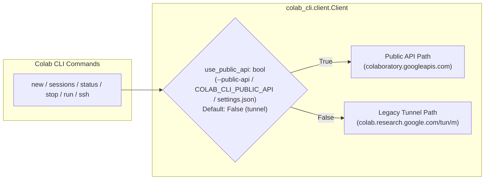

# 計畫：以雙支援方式遷移到 Colab Public API

## 1. 工作樹的背景

1. **為什麼需要雙 API 支援**：新的 Public API（`colaboratory.googleapis.com`）同時需要 `colaboratory` OAuth 範圍，以及已列入 `colaboratory.googleapis.com` 允許清單的 OAuth 用戶端／ADC 配額專案。透過 `--auth=adc` 在使用者預設 GCP 專案下鑄造的憑證、自訂 `-c/--client-oauth-config` 檔案，或沒有 `colaboratory` 範圍的舊權杖，可能會被 `colaboratory.googleapis.com` 拒絕（HTTP 403），但對舊版工作階段通道（`colab.research.google.com/tun/m/...`，只需要 `userinfo.email`）仍然有效。

2. **[`2bdb30a6`](file:///usr/local/google/home/sethtroisi/Projects/colab-cli/src/colab_cli/client.py)（`moving to Colab Public API`）與工作樹（`src/openapi/`）**：
   - 在 [`ColabEnvironment`](file:///usr/local/google/home/sethtroisi/Projects/colab-cli/src/colab_cli/client.py#L47-L50) 與 [`Prod`](file:///usr/local/google/home/sethtroisi/Projects/colab-cli/src/colab_cli/client.py#L54-L57) 新增 `public_api: str = "https://colaboratory.googleapis.com"`。
   - 在 [client.py](file:///usr/local/google/home/sethtroisi/Projects/colab-cli/src/colab_cli/client.py#L150-L185) 新增 Pydantic 模型（`PublicVariant`、`PublicShape`、`ConnectionInfo`、`RuntimeSpecKey`、`Runtime`、`ListRuntimesResponse`），並就地取代 [`Client.list_assignments()`](file:///usr/local/google/home/sethtroisi/Projects/colab-cli/src/colab_cli/client.py#L301-L351)，改為呼叫 `GET /v1beta/runtimes`。
   - 將 [`assign()`](file:///usr/local/google/home/sethtroisi/Projects/colab-cli/src/colab_cli/client.py#L361-L403)、[`unassign()`](file:///usr/local/google/home/sethtroisi/Projects/colab-cli/src/colab_cli/client.py#L353-L359) 與 [`get_consumption_user_info()`](file:///usr/local/google/home/sethtroisi/Projects/colab-cli/src/colab_cli/client.py#L295-L299) 留在 `/tun/m/...` 上。
   - `src/openapi/` 中未提交的檔案（從 `api.tar.gx` 抽出）包含產生的 OpenAPI 模型與 `httpx` stub，涵蓋 `GetRuntime`、`ListRuntimes`、`CreateRuntime`、`DeleteRuntime`、`ListRuntimeSpecs` 與 `GetSubscription`。

---

## 2. 關鍵協定與資料模型差異

| 能力 | 舊版通道 API（`/tun/m/...`）— **預設** | 新 Public API（`colaboratory.googleapis.com`）— `--public-api` | 需要的關鍵調整 |
| :--- | :--- | :--- | :--- |
| **列出工作階段** | `GET /tun/m/assignments`（帶 XSSI 前綴的 `ListedAssignments`） | `GET /v1beta/runtimes`（`ListRuntimesResponse`） | 將 `Runtime` 對映為 `ListedAssignment`。除了 `endpoint` 之外，也儲存 `runtime.name`（`runtimes/{runtime_id}`）。 |
| **建立工作階段（`assign`）** | 兩步 XSRF（`GET /tun/m/assign?nbh=<b64>` + 帶 `X-Goog-Colab-Token` 的 `POST /tun/m/assign`） | LRO：`POST /v1beta/runtimes?runtimeId=<id>&requestId=<uuid>` -> 回傳 `Operation`（`operations/<op_id>`），接著輪詢 `GET /v1/{op_name}:wait`（或 `GET /v1/{op_name}`）直到 `done: true` | 產生符合 RFC-1034 的 `runtimeId`（`r-<uuid4>`），而不是 44 字元的 base64 `nbh`。從 `operation.response` 解出 `Runtime`，並將 LRO `operation.error` 代碼對映為 `TooManyAssignmentsError` / `ColabRequestError`。 |
| **刪除工作階段（`unassign`）** | 兩步 XSRF（`GET` + `POST /tun/m/unassign/{endpoint}`） | `DELETE /v1beta/{name=runtimes/*}?allowMissing=true` | **關鍵**：`DeleteRuntime` 接受的是 `runtimes/{runtime_id}`（即 `notebook_id_hash`），**不是** `endpoint`（`m-s-...`）。[`SessionState`](file:///usr/local/google/home/sethtroisi/Projects/colab-cli/src/colab_cli/state.py#L25-L38) 必須持久化 `runtime_name`。 |
| **權杖刷新** | 以 `endpoint` 比對的 `GET /tun/m/assignments` | `GET /v1beta/runtimes`（或 `GET /v1beta/{name=runtimes/*}`） | 透過 `list_assignments()` 刷新（以 `runtime_name` 或 `endpoint` 比對）。 |
| **使用資訊（`colab usage`）** | `GET /tun/m/ccu-info`（CCU 餘額、消耗率、作用中數量） | `GET /tun/m/ccu-info` | 兩種模式都呼叫 `/tun/m/ccu-info`。 |

> [!IMPORTANT]
> **`runtime_name` 與 `endpoint` 的身分區別**：
> 在 `colaboratory.googleapis.com` 上，執行期的資源名稱是 `runtimes/{runtime_id}`（其中 `{runtime_id}` 在內部儲存為 `notebook_id_hash`），而 `connectionInfo.endpoint` 是標記為 `COLAB_INTERNAL` 可見性的內部虛擬機器識別碼（`m-s-...`）。`DeleteRuntime` 與 `GetRuntime` 以 `{runtime_id}` 查找配置，**不是**以 `endpoint`。在 [`SessionState`](file:///usr/local/google/home/sethtroisi/Projects/colab-cli/src/colab_cli/state.py#L25-L38) 與 [`ListedAssignment`](file:///usr/local/google/home/sethtroisi/Projects/colab-cli/src/colab_cli/client.py#L138-L144) 上持久化 `runtime_name: Optional[str] = None`，能讓兩個 API 無縫共存。

---

## 3. 逐步遷移計畫

### 步驟 1：清理工作樹並整合模型
1. 移除未追蹤的 `api.tar.gx` 封存與產生的 `src/openapi/` 目錄（它引入了外部 `httpx` 依賴與非套件的頂層模組）。
2. 將所有 Public API Pydantic 模型保留在 [`src/colab_cli/client.py`](file:///usr/local/google/home/sethtroisi/Projects/colab-cli/src/colab_cli/client.py) 中，使用既有的 `requests` + `pydantic` 堆疊：
   - `PublicVariant`、`PublicShape`、`ConnectionInfo`、`RuntimeSpecKey`、`Runtime`、`ListRuntimesResponse`（其中 `ConnectionInfo.endpoint: Optional[str] = None`，以防非內部 OAuth 專案剝除 `COLAB_INTERNAL` 欄位）。
   - 為 `CreateRuntime` 與 `/v1/operations/...` 新增 `Status`（`code`、`message`、`details`）與 `Operation`（`name`、`done`、`metadata`、`error`、`response`）。

### 步驟 2：新增 `--public-api / --no-public-api` 旗標、環境變數與 `Settings.use_public_api`
1. **擴充 [`src/colab_cli/state.py`](file:///usr/local/google/home/sethtroisi/Projects/colab-cli/src/colab_cli/state.py) 中的 [`Settings`](file:///usr/local/google/home/sethtroisi/Projects/colab-cli/src/colab_cli/state.py#L40-L46)**：
   - 在 `Settings` 新增 `use_public_api: bool = False`（持久化於 `~/.config/colab-cli/settings.json`，預設 `False`，使通道 API 保持為預設）。
2. **在 [`src/colab_cli/cli.py`](file:///usr/local/google/home/sethtroisi/Projects/colab-cli/src/colab_cli/cli.py#L58-L96) 新增全域 `--public-api / --no-public-api` 選項**：
   - 新增 `public_api: Annotated[Optional[bool], typer.Option("--public-api/--no-public-api", envvar="COLAB_CLI_PUBLIC_API", help="Use the Colab Public API (colaboratory.googleapis.com) instead of the legacy tunnel API.")] = None`。
   - 儲存 `state.use_public_api = public_api`（`Optional[bool]`，其中 `None` 表示「交由 `settings.json` 決定」）。
3. **在 [`State.client`](file:///usr/local/google/home/sethtroisi/Projects/colab-cli/src/colab_cli/common.py#L70-L77)（`src/colab_cli/common.py`）解析優先順序**：
   - 解析順序：
     1. 明確的 `--public-api` / `--no-public-api` CLI 旗標或 `COLAB_CLI_PUBLIC_API` 環境變數（`if self.use_public_api is not None`）。
     2. 持久化的 `self.settings_store.load().use_public_api`（預設 `False`）。
   - 將 `use_public_api=resolved_bool` 傳入 `Client(Prod(), creds, use_public_api=resolved_bool)`。

### 步驟 3：新增驗證能力探測工具、快取與隱藏的 `colab test-public-api` 指令
1. **為快取擴充 [`src/colab_cli/state.py`](file:///usr/local/google/home/sethtroisi/Projects/colab-cli/src/colab_cli/state.py) 中的 [`Settings`](file:///usr/local/google/home/sethtroisi/Projects/colab-cli/src/colab_cli/state.py#L40-L46)**：
   - 在 `~/.config/colab-cli/settings.json` 的 `Settings` 新增快取探測欄位：
     - `public_api_supported: Optional[bool] = None`
     - `tunnel_api_supported: Optional[bool] = None`
2. **實作探測工具函式（`check_api_access`）**：
   - 新增一個工具函式（例如放在 [`src/colab_cli/commands/utility.py`](file:///usr/local/google/home/sethtroisi/Projects/colab-cli/src/colab_cli/commands/utility.py) 或 [`src/colab_cli/client.py`](file:///usr/local/google/home/sethtroisi/Projects/colab-cli/src/colab_cli/client.py)），執行輕量、唯讀的 GET 探測（不配置任何虛擬機器資源）：
     - **Public API 檢查**：`GET https://colaboratory.googleapis.com/v1beta/runtimes`（`_list_assignments_public()`）。
     - **通道 API 檢查**：`GET https://colab.research.google.com/tun/m/assignments`（`_list_assignments_tunnel()`）。
   - 記錄每個呼叫是成功（`True`）還是以驗證／權限錯誤失敗（`False`，擷取 HTTP 狀態碼與原因），將 `public_api_supported` 與 `tunnel_api_supported` 持久化到 `state.settings_store`，並輸出每個後端的結果。
3. **註冊隱藏的 `colab test-public-api` 子指令**：
   - 在 [`src/colab_cli/commands/utility.py`](file:///usr/local/google/home/sethtroisi/Projects/colab-cli/src/colab_cli/commands/utility.py#L390-L402) 中，註冊 `app.command(name="test-public-api", hidden=True)(test_public_api)`（與 `whoami` 並列）。
   - 在 [`src/colab_cli/cli.py`](file:///usr/local/google/home/sethtroisi/Projects/colab-cli/src/colab_cli/cli.py#L109-L121) 的 `_AUTO_UPDATE_SUPPRESSED` 中新增 `"test-public-api"`，使每日更新檢查橫幅不會污染診斷輸出。
4. **在驗證錯誤處理中使用快取的探測結果**：
   - 當 `Client._issue_request`（或指令層級的錯誤處理）對任一後端遇到 HTTP 401/403 時，更新該後端的快取旗標（`False`），並查閱 `Settings` 中另一後端的快取狀態：
     - 若 Public API 請求以 401/403 失敗且 `tunnel_api_supported` 為 `True`，呈現提示，說明目前憑證無法存取 `colaboratory.googleapis.com`，並建議 `--no-public-api`（或用 `colab test-public-api` 檢視）。
     - 若通道 API 請求以 401/403 失敗且 `public_api_supported` 為 `True`，建議 `--public-api`。
     - 若兩者都尚未探測，或兩者都是 `False`，建議執行 `colab whoami` 診斷範圍與專案存取權。

### 步驟 4：更新 `SessionState` 與 `Client` 回應模型，以支援跨 API 身分
1. **更新 [`SessionState`](file:///usr/local/google/home/sethtroisi/Projects/colab-cli/src/colab_cli/state.py#L25-L38)**：
   - 新增 `runtime_name: Optional[str] = None`（例如 `"runtimes/r-..."`）。沒有 `runtime_name` 的既有 `sessions.json` 項目能以 `None` 乾淨地反序列化。
2. **更新 [`ListedAssignment`](file:///usr/local/google/home/sethtroisi/Projects/colab-cli/src/colab_cli/client.py#L138-L144)、[`PostAssignmentResponse`](file:///usr/local/google/home/sethtroisi/Projects/colab-cli/src/colab_cli/client.py#L187-L192) 與 [`Assignment`](file:///usr/local/google/home/sethtroisi/Projects/colab-cli/src/colab_cli/client.py#L205-L208)**：
   - 在每個模型新增 `runtime_name: Optional[str] = None`。
   - 在 Public API 回應中，填入 `runtime_name = runtime.name` 與 `endpoint = runtime.connection_info.endpoint or runtime.name.removeprefix("runtimes/")`。
3. **更新 [`common.py`](file:///usr/local/google/home/sethtroisi/Projects/colab-cli/src/colab_cli/common.py#L86-L148)（`get_session` 與 `sync_sessions`）、[`commands/session.py`](file:///usr/local/google/home/sethtroisi/Projects/colab-cli/src/colab_cli/commands/session.py) 與 [`commands/run.py`](file:///usr/local/google/home/sethtroisi/Projects/colab-cli/src/colab_cli/commands/run.py)**：
   - 在 `new()` 與 `run_command()` 建立工作階段時，持久化 `runtime_name=getattr(res, "runtime_name", None)`。
   - 在 `get_session()` 與 `sync_sessions()` 中，以 `endpoint` 將本地工作階段與伺服器配置比對（或在 `endpoint` 不符時以 `runtime_name` 比對），並在存在時回填 `s.runtime_name = a.runtime_name`。
   - 在 `session.stop()` 與 `run.py` 呼叫 `state.client.unassign(s.endpoint, runtime_name=s.runtime_name)` 時傳入 `runtime_name=s.runtime_name`。

### 步驟 5：在 `Client` 中實作雙路徑方法（`src/colab_cli/client.py`）
1. **`list_assignments()`**：
   - 依 `self.use_public_api` 分派到 `_list_assignments_public()`（`GET /v1beta/runtimes`）或 `_list_assignments_tunnel()`（`GET /tun/m/assignments`）。
2. **`assign(notebook_hash, variant, accelerator, shape)`**：
   - 依 `self.use_public_api` 分派到 `_assign_public(...)` 或 `_assign_tunnel(...)`。
   - **`_assign_tunnel()`**：既有的兩步 `GET`/`POST /tun/m/assign`，帶 XSRF 權杖與重試／退避恢復。
   - **`_assign_public()`**：
     - 格式化 `runtime_id = f"r-{notebook_hash}"`（符合 `^[a-z]([a-z0-9-]{0,61}[a-z0-9])?$`）與 `request_id = str(uuid.uuid4())`。
     - 將 `(variant, accelerator, shape)` 對映為 `RuntimeSpecKey`（`VARIANT_CPU`/`VARIANT_GPU`/`VARIANT_TPU`、加速器字串，若 `shape == Shape.HIGH_RAM` 則 `SHAPE_HIGHMEM`，否則 `SHAPE_STANDARD`）。
     - 以 JSON 主體 `{"runtimeSpec": ...}` 發出 `POST /v1beta/runtimes?runtimeId={runtime_id}&requestId={request_id}`，並解析 `Operation`。
     - 輪詢 `GET /v1/{operation.name}:wait?timeout=30s`（或 `GET /v1/{operation.name}`）直到 `operation.done` 為 `True`，在暫時性 HTTP/逾時錯誤時遵守 `COLAB_CLI_ASSIGN_RETRIES` 與 `COLAB_CLI_RETRY_BACKOFF`。
     - 處理 `operation.error`：
       - `code == 9`（`FAILED_PRECONDITION`）-> 拋出 `TooManyAssignmentsError`（包括 `operation.error.message`）。
       - `code == 6`（`ALREADY_EXISTS`）-> 呼叫 `_get_runtime_public(f"runtimes/{runtime_id}")`（`GET /v1beta/runtimes/{runtime_id}`）並回傳 `Assignment`。
       - `code in (3, 7)`（`INVALID_ARGUMENT`、`PERMISSION_DENIED`）-> 拋出帶對映 HTTP 狀態（400 / 403）的 `ColabRequestError`，使 `session.py` / `run.py` 中呼叫端的資格處理常式維持不變。
     - 從 `operation.response` 解析 `Runtime` 並回傳 `PostAssignmentResponse`。
3. **`unassign(endpoint, runtime_name=None)`**：
   - 依 `self.use_public_api` 分派到 `_unassign_public(endpoint, runtime_name=runtime_name)` 或 `_unassign_tunnel(endpoint)`。
   - **`_unassign_tunnel(endpoint)`**：既有的 `GET` + 帶 `X-Goog-Colab-Token` 的 `POST /tun/m/unassign/{endpoint}`。
   - **`_unassign_public(endpoint, runtime_name=None)`**：
     - 解析 `runtime_name`：若未提供，檢查 `endpoint` 是否以 `runtimes/` 或 `r-` 開頭；否則查詢 `_list_assignments_public()` 找出 `endpoint` 相符的執行期。
     - 以 `schema=None` 發出 `DELETE /v1beta/{runtime_name}?allowMissing=true`。
4. **`get_consumption_user_info()`**：
   - 兩種模式都保留在 `GET /tun/m/ccu-info`。

### 步驟 6：雙 API 支援的測試策略
1. **[`tests/test_client.py`](file:///usr/local/google/home/sethtroisi/Projects/colab-cli/tests/test_client.py) 中的單元測試**：
   - **預設（`use_public_api=False`）通道套件**：
     - 還原 `test_client_list_assignments`，測試帶 XSSI 前綴的 `GET /tun/m/assignments`。
     - 讓所有既有的 `assign`（`_get_assignment` + `_post_assignment`、重試、412、shape=hm）與 `unassign`（`/tun/m/unassign/{endpoint}`）測試，繼續對預設的 `Client(Prod(), mock_session)` 通過。
   - **Public API（`use_public_api=True`）套件**：
     - `test_public_client_list_assignments`：`GET /v1beta/runtimes` 對映 variant、shape、加速器、`expireTime`、`runtime_name`，以及空回應 `{}`。
     - `test_public_client_assign_immediate` 與 `test_public_client_assign_polls_until_done`：`POST /v1beta/runtimes` 回傳 `Operation(done=False)`，接著 `GET /v1/operations/...:wait` 回傳 `Operation(done=True, response=Runtime)`。
     - `test_public_client_assign_failed_precondition_raises_too_many_assignments`：`Operation(done=True, error={"code": 9, ...})` 拋出 `TooManyAssignmentsError`。
     - `test_public_client_assign_invalid_argument_raises_400`：`Operation(done=True, error={"code": 3, ...})` 拋出狀態 400 的 `ColabRequestError`（驗證 `colab new --gpu A100` 的資格錯誤處理）。
     - `test_public_client_assign_already_exists_recovers`：`Operation(done=True, error={"code": 6})` 透過 `GET /v1beta/runtimes/{runtime_id}` 恢復。
     - `test_public_client_unassign_with_runtime_name` 與 `test_public_client_unassign_resolves_endpoint`：帶 `allowMissing=true` 的 `DELETE /v1beta/runtimes/r-...`。
     - `test_auth_error_uses_cached_probe_for_remediation_hint`：驗證 Public API 上的 401/403 會查閱快取的 `tunnel_api_supported`（反之亦然），以納入可操作的退回建議。
2. **CLI、探測指令、Common 與 State 單元測試（[`tests/test_cli.py`](file:///usr/local/google/home/sethtroisi/Projects/colab-cli/tests/test_cli.py)、[`tests/test_common.py`](file:///usr/local/google/home/sethtroisi/Projects/colab-cli/tests/test_common.py)、[`tests/test_state.py`](file:///usr/local/google/home/sethtroisi/Projects/colab-cli/tests/test_state.py)）**：
   - 測試 `--public-api` / `--no-public-api` 旗標、`COLAB_CLI_PUBLIC_API` 環境變數、`Settings.use_public_api`，以及預設（`False`）的優先順序。
   - 測試 `colab test-public-api`：
     - 在 `colab --help` 中隱藏，可透過 `colab test-public-api --help` 抵達。
     - 探測 `colaboratory.googleapis.com/v1beta/runtimes` 與 `colab.research.google.com/tun/m/assignments`，印出各自狀態，並在 `SettingsStore` 中持久化 `public_api_supported` 與 `tunnel_api_supported`。
   - 驗證帶 `runtime_name` 的 `SessionState` 來回持久化，以及缺少 `runtime_name` 時的向後相容載入。
   - 驗證 `session.stop` 與 `run` 將 `runtime_name` 轉發給 `client.unassign`。
3. **真實端到端整合測試（`integration/`）**：
   - 新增 `integration/repro_public_api/test.sh`，實際測試 `colab test-public-api`、`colab --public-api new`、`colab --public-api sessions`、`colab --public-api status`、`colab --public-api exec` 與 `colab --public-api stop`，外加透過 `colab sessions` 驗證沒有留下孤兒工作階段。

### 步驟 7：更新文件
- 更新 [`AGENTS.md`](file:///usr/local/google/home/sethtroisi/Projects/colab-cli/AGENTS.md)、[`docs/01_session_management.md`](file:///usr/local/google/home/sethtroisi/Projects/colab-cli/docs/01_session_management.md) 與 [`docs/04_automation_and_utility.md`](file:///usr/local/google/home/sethtroisi/Projects/colab-cli/docs/04_automation_and_utility.md)（並附 frontmatter 日誌條目），記錄 `--public-api / --no-public-api`、`colab test-public-api`、`Settings.use_public_api` 與雙後端架構。
